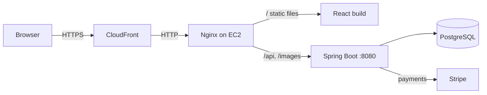

# E-Shop

A full-stack online store built with **Spring Boot** and **React**, running on **AWS**.
Shoppers browse and pay, sellers manage their own products, and admins run the catalog.

**Live site:** https://d1loonx3il11ot.cloudfront.net
· **API docs:** https://d1loonx3il11ot.cloudfront.net/swagger-ui/index.html

**Try it:** on the login page, **Try as shopper** creates a throwaway account just for you, and
**Try as admin** opens the admin panel read-only. Payments use Stripe's test mode: pay with card
`4242 4242 4242 4242`, any future date and any CVC. The store resets every night.

## Features

| Shoppers | Sellers | Admins |
|---|---|---|
| Browse, search, filter and sort products | Add and edit their own products | Dashboard with product, order and revenue totals |
| Cart and saved delivery addresses | Upload product images | Manage categories, products and sellers |
| Checkout with Stripe (test mode) | View orders and update their status | Update the status of any order |

## Tech stack

| Layer | Technologies |
|---|---|
| Backend | Java 21, Spring Boot 4, Spring Security with JWT (in a cookie), Spring Data JPA / Hibernate, PostgreSQL, Stripe API, springdoc OpenAPI |
| Frontend | React 19, Redux Toolkit, React Router 7, Tailwind CSS 4, Material UI, Vite 7 |
| Infrastructure | AWS EC2 (t4g.micro, Ubuntu 24.04), Amazon CloudFront, Nginx, systemd, Bash deploy scripts |

## Architecture



The site and the API share one address: Nginx serves the React build and forwards `/api` and `/images`
to Spring Boot. That keeps the login cookie same-origin, so no CORS setup is needed in production.
Spring Boot and PostgreSQL only listen on localhost. Everything runs on one small instance for about
$9/month; see [deploy/README.md](deploy/README.md).

## Changes beyond the course

This started as the project from the [EmbarkX Spring Boot course](https://github.com/EmbarkXOfficial/spring-boot-course).
Changes since then:

- **Deployed to AWS** on a single EC2 instance behind CloudFront, with scripts for server setup,
  one-command deploys, password changes and data copies ([deploy/](deploy/))
- **Moved secrets out of the code**: database credentials, JWT secret and Stripe key now come from
  environment variables
- **Fixed the frontend build**: added the missing Vite React config (pages crashed with
  "React is not defined") and moved the styles to Tailwind CSS v4 syntax
- **Replaced the course placeholders** with an About page describing the project, a real Contact page,
  a site footer, page metadata, a favicon and a link-preview image
- **Public demo mode** ([demo package](sb-ecom/src/main/java/com/ecommerce/project/demo/)):
  - one-click demo logins: each shopper gets their own throwaway account
  - a shared demo admin that a Spring Security filter keeps read-only
  - a nightly reset to a saved snapshot, run by a systemd timer
  - a test-card banner
- **A real catalog**: 35 products in 5 categories, loaded through the app's own REST API by
  [a seed script](deploy/demo/seed_catalog.py)
- **Fixed checkout for shoppers**: the route guard sent anyone without an admin or seller role
  away from checkout. Logging in now also returns you to the page you were on.
- **Smaller fixes**: home banners whose text didn't match their pictures, stretched product photos,
  the 1 MB upload limit, and startup accounts with public passwords (now configurable and off on the server)

## Running it locally

You need Java 21, Node.js 20+ and PostgreSQL.

**Database**

```bash
createdb ecommerce          # tables are created on first start
```

**Backend** (port 8080)

```bash
cd sb-ecom
export DB_PASSWORD=your-postgres-password
export JWT_SECRET=$(openssl rand -base64 32)
export STRIPE_SECRET_KEY=sk_test_...
./mvnw spring-boot:run
```

`DB_URL` and `DB_USERNAME` default to `jdbc:postgresql://localhost:5432/ecommerce` and `postgres`.
On startup the app creates `admin` (password `adminPass`, or `ADMIN_PASSWORD` if set) and, for local
development, `user1` / `password1` and `seller1` / `password2`. Set `DEMO_MODE=true` to try the demo
buttons and banner locally.

**Frontend** (port 5173). Create `ecom-frontend/.env.development.local`:

```
VITE_BACK_END_URL=http://localhost:8080
VITE_FRONTEND_URL=http://localhost:5173
VITE_STRIPE_PUBLISHABLE_KEY=pk_test_...
```

then:

```bash
cd ecom-frontend
npm install
npm run dev
```

Pay with Stripe's test card `4242 4242 4242 4242`, any future expiry date and any CVC.

## Project layout

```
sb-ecom/          Spring Boot backend
ecom-frontend/    React frontend
deploy/           AWS server setup and deploy scripts
```

## Credits

- Started from the [EmbarkX Spring Boot course](https://github.com/EmbarkXOfficial/spring-boot-course) project
- Demo product data and photos from [DummyJSON](https://dummyjson.com) (MIT License)
