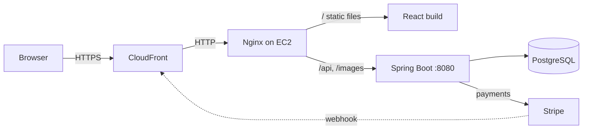
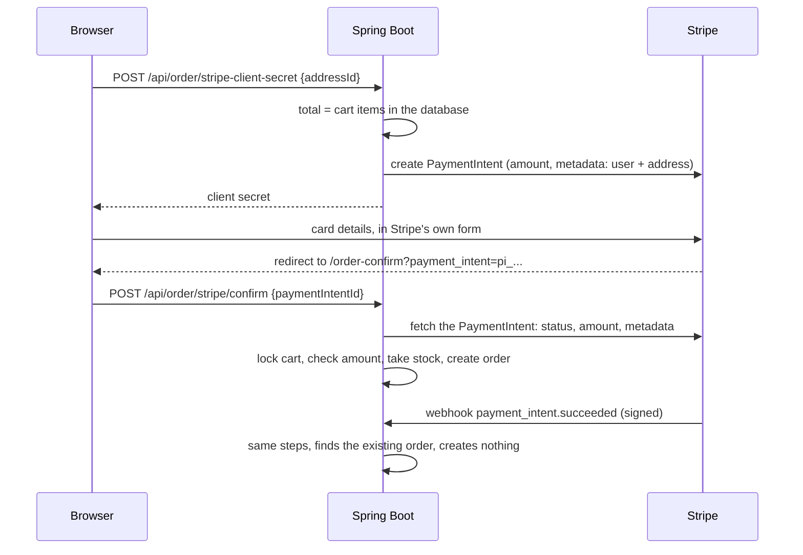

# E-Shop

[](https://github.com/bgorantla/sb-ecom/actions/workflows/ci.yml)

A full-stack online store built with **Spring Boot** and **React**, running on **AWS**.
Shoppers browse and pay, sellers manage their own products, and admins run the catalog.

**Live site:** https://d1loonx3il11ot.cloudfront.net
· **API docs:** https://d1loonx3il11ot.cloudfront.net/swagger-ui/index.html

**Try it:** on the login page, **Try as shopper** creates a throwaway account just for you, and
**Try as admin** opens the admin panel read-only. Payments use Stripe's test mode: pay with card
`4242 4242 4242 4242`, any future date and any CVC. The store resets every night.

## Features

| Shoppers | Sellers | Admins |
|---|---|---|
| Browse, search, filter and sort products | Add and edit their own products | Dashboard with product, order and revenue totals |
| Cart and saved delivery addresses | Upload product images | Manage categories, products and sellers |
| Checkout with Stripe (test mode) | View orders and update their status | Update the status of any order |

## Tech stack

| Layer | Technologies |
|---|---|
| Backend | Java 21, Spring Boot 4, Spring Security with JWT (in a cookie), Spring Data JPA / Hibernate, PostgreSQL, Stripe API, springdoc OpenAPI |
| Frontend | React 19, Redux Toolkit, React Router 7, Tailwind CSS 4, Material UI, Vite 7 |
| Infrastructure | AWS EC2 (t4g.micro, Ubuntu 24.04), Amazon CloudFront, Nginx, systemd, Bash deploy scripts |
| Testing and CI/CD | JUnit 6, Spring Boot Test with MockMvc, H2, Vitest, React Testing Library, GitHub Actions with AWS OIDC |

## Architecture



The site and the API share one address: Nginx serves the React build and forwards `/api` and `/images`
to Spring Boot. That keeps the login cookie same-origin, so no CORS setup is needed in production.
Spring Boot and PostgreSQL only listen on localhost. Everything runs on one small instance for about
$9/month; see [deploy/README.md](deploy/README.md).

## How checkout works

The browser never tells the server how much to charge or whether a payment succeeded.



- **One order per payment.** The confirm call and the webhook can arrive together. Both lock the
  shopper's cart row (`SELECT ... FOR UPDATE`), and the second one finds the order the first created.
- **No overselling.** Stock is taken with `UPDATE ... SET quantity = quantity - n WHERE quantity >= n`,
  which fails instead of going negative when two people buy the last item.
- **Refunds.** If a paid cart can't become an order (an item sold out, or the cart changed during
  payment), the payment is refunded automatically and the shopper is told why.
- **Webhook** at `/api/webhooks/stripe`: needs no login, but every call must carry a valid Stripe
  signature. It catches payments whose shopper closed the tab before coming back.

## Changes beyond the course

This started as the project from the [EmbarkX Spring Boot course](https://github.com/EmbarkXOfficial/spring-boot-course).
Changes since then:

- **Deployed to AWS** on a single EC2 instance behind CloudFront, with scripts for server setup,
  one-command deploys, password changes and data copies ([deploy/](deploy/))
- **Moved secrets out of the code**: database credentials, JWT secret and Stripe key now come from
  environment variables
- **Fixed the frontend build**: added the missing Vite React config (pages crashed with
  "React is not defined") and moved the styles to Tailwind CSS v4 syntax
- **Replaced the course placeholders** with an About page describing the project, a real Contact page,
  a site footer, page metadata, a favicon and a link-preview image
- **Public demo mode** ([demo package](sb-ecom/src/main/java/com/ecommerce/project/demo/)):
  - one-click demo logins: each shopper gets their own throwaway account
  - a shared demo admin that a Spring Security filter keeps read-only
  - a nightly reset to a saved snapshot, run by a systemd timer
  - a test-card banner
- **A real catalog**: 35 products in 5 categories, loaded through the app's own REST API by
  [a seed script](deploy/demo/seed_catalog.py)
- **Fixed checkout for shoppers**: the route guard sent anyone without an admin or seller role
  away from checkout. Logging in now also returns you to the page you were on.
- **Secure checkout** ([CheckoutService](sb-ecom/src/main/java/com/ecommerce/project/service/CheckoutService.java)):
  - the original code took the amount from the browser and created the order when the browser said
    "payment succeeded"
  - now works as described in [How checkout works](#how-checkout-works)
- **Closed data leaks**: any logged-in user could list everyone's addresses and carts, and read, edit
  or delete other people's addresses. Errors on protected endpoints also came back as 401 instead
  of their real status.
- **Honest confirmation page**: it used to say "Payment Successful!" whatever happened
- **Tests and CI/CD**: see [Tests](#tests). GitHub Actions runs them on every push and pull request,
  and deploys to EC2 when they pass on master. The tests turned up bugs that are now fixed: the
  admin "all carts" endpoint answered 400 or 302 instead of 200, a crash in the product form's error
  handling, and a product popup that wouldn't close on Esc or an outside click
- **Smaller fixes**: home banners whose text didn't match their pictures, stretched product photos,
  the 1 MB upload limit, and startup accounts with public passwords (now configurable and off on the server)

## Running it locally

You need Java 21, Node.js 22.12+ and PostgreSQL.

**Database**

```bash
createdb ecommerce          # tables are created on first start
```

**Backend** (port 8080)

```bash
cd sb-ecom
export DB_PASSWORD=your-postgres-password
export JWT_SECRET=$(openssl rand -base64 32)
export STRIPE_SECRET_KEY=sk_test_...
./mvnw spring-boot:run
```

`DB_URL` and `DB_USERNAME` default to `jdbc:postgresql://localhost:5432/ecommerce` and `postgres`.
On startup the app creates `admin` (password `adminPass`, or `ADMIN_PASSWORD` if set) and, for local
development, `user1` / `password1` and `seller1` / `password2`. Set `DEMO_MODE=true` to try the demo
buttons and banner locally.

**Frontend** (port 5173). Create `ecom-frontend/.env.development.local`:

```
VITE_BACK_END_URL=http://localhost:8080
VITE_FRONTEND_URL=http://localhost:5173
VITE_STRIPE_PUBLISHABLE_KEY=pk_test_...
```

then:

```bash
cd ecom-frontend
npm install
npm run dev
```

Pay with Stripe's test card `4242 4242 4242 4242`, any future expiry date and any CVC.

## Tests

```bash
cd sb-ecom && ./mvnw test          # backend: about 30 tests, under a minute
cd ecom-frontend && npm test       # frontend: lint is separate (npm run lint)
```

**Backend.** The API tests start the whole app (security filters, controllers, services, an
in-memory H2 database) and call it over HTTP the way the browser does, signed in with a real JWT
cookie. Only Stripe is replaced, by [FakeStripe](sb-ecom/src/test/java/com/ecommerce/project/support/FakeStripe.java),
which lets a test decide whether each payment succeeds while checking webhook signatures with
Stripe's real code.

- [CheckoutApiTest](sb-ecom/src/test/java/com/ecommerce/project/checkout/CheckoutApiTest.java):
  the server sets the amount, nobody can claim another shopper's payment, forged webhooks are
  rejected, the last item in stock goes to one buyer and the other is refunded, and eight
  simultaneous reports of one payment create exactly one order
- [AccessRulesTest](sb-ecom/src/test/java/com/ecommerce/project/security/AccessRulesTest.java):
  shoppers can't see or change each other's addresses, and admin-only endpoints are admin-only
- [DemoModeTest](sb-ecom/src/test/java/com/ecommerce/project/demo/DemoModeTest.java):
  the demo admin can look at everything and change nothing
- [CartTotalsTest](sb-ecom/src/test/java/com/ecommerce/project/util/CartTotalsTest.java):
  money in cents, rounded correctly

Each safeguard was checked by removing it: without the cart lock, the concurrency test finds
duplicate orders; without the stock check, the last-item test oversells.

**Frontend.** [Vitest](https://vitest.dev) and React Testing Library render components in a fake
browser page: the payment confirmation page (it waits for the server before saying "Order placed"),
the search and filter bar, the cart reducer and price formatting.

## Project layout

```
sb-ecom/          Spring Boot backend
ecom-frontend/    React frontend
deploy/           AWS server setup and deploy scripts
.github/          GitHub Actions workflow: tests on every push, deploy from master
```

## Credits

- Started from the [EmbarkX Spring Boot course](https://github.com/EmbarkXOfficial/spring-boot-course) project
- Demo product data and photos from [DummyJSON](https://dummyjson.com) (MIT License)
